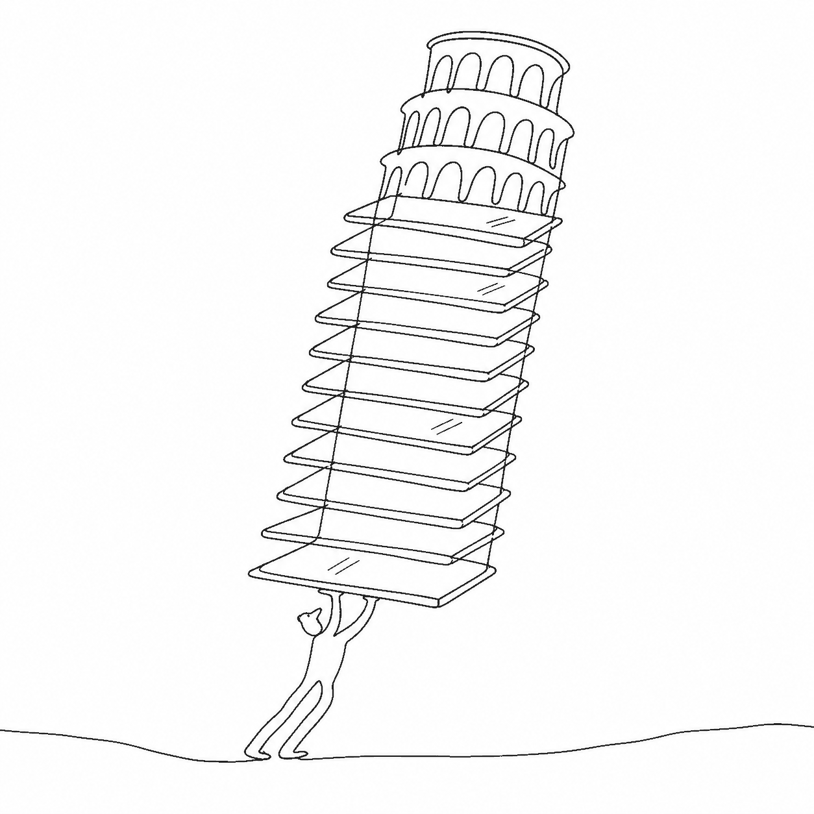

# vexy-stax

{ width="96" }

vexy-stax renders a deck of layered PNG slides as 3D glass plates. You describe the deck once, in a JSON scene file, and vexy-stax produces:

- an **expanded** still: an angled hero shot with the plates spaced apart and captions visible,
- a **compact** still: a head-on stack with the plates collapsed into one composite image,
- a **transition** video that morphs between the two views.

This site documents **vexy-stax-py**, the offline Python package. It is published on PyPI as `vexy-stax` and installs the `vexy-stax` command. A browser sibling, [vexy-stax-js](https://vexy.dev/vexy-stax-js/), reads the same scene format and renders it with three.js.

## What goes in, what comes out

Input is a folder of layered images (for example, the layers you export from a design tool) and a scene file that lists them back to front:

```json
{
  "version": 1,
  "slides": [
    { "src": "layer-0-background.png" },
    { "src": "layer-1-content.png" },
    { "src": "layer-2-ui.png" }
  ]
}
```

Every other scene field has a default. From that file the `vexy-stax` command renders:

```bash
vexy-stax render scene.json --view expanded --out beauty.png   # angled hero shot
vexy-stax render scene.json --view compact  --out stack.png    # head-on stack
vexy-stax video  scene.json --out morph.mp4                    # needs a "transition" block
vexy-stax overlay scene.json --out flat.png                    # flat 2D composite, no 3D engine
```

You don't have to write the scene by hand: `vexy-stax dir2scene assets/` scans a folder and writes one for you.

## Three engines, one geometry

vexy-stax-py draws with one of three interchangeable engines:

| Engine | How it draws | Default for |
|--------|--------------|-------------|
| `pygfx` | Off-screen GPU rendering with pygfx/WGPU | stills (`render`) |
| `blender` | Runs Blender in the background with Cycles (or Eevee in turbo mode) | video (`video`) |
| `playwright` | Loads the built vexy-stax-js bundle in headless Chromium | — |

All three take their camera poses, plate spacing and opacities from one module, `vexy_stax.geometry`. The engines differ only in how they draw, so the same scene frames the same way in every engine.

## Live demos

The browser renderer runs these demos:

- [Animated demo](https://vexy.dev/vexy-stax-js/playable.html): play the compact-to-expanded transition, or toggle the two views by hand.
- [Scrollspy demo](https://vexy.dev/vexy-stax-js/scrollable.html): the deck rises into view and unfolds as you scroll.

## Where to go next

- [Installation](installation.md): install the package and the optional engine prerequisites.
- [Quick start](quickstart.md): go from a folder of PNGs to stills and a video.
- [Concepts](concepts.md): plates, the deck, the two views, transitions, the floor.
- [Scene format](scene-format.md) and [Scene reference](scene-reference.md): every field of the JSON file.
- [CLI](cli.md): every command and flag.
- [Engines](engines.md): what each engine needs and how it renders.
- [Python API](python-api.md): use vexy-stax as a library.

## License

See the `LICENSE` file in the repository. The bundled caption font (`vexy-stax.ttf`, Zalando Sans Expanded) is distributed under the SIL Open Font License; its text ships as `src/vexy_stax/fonts/OFL.txt`.
